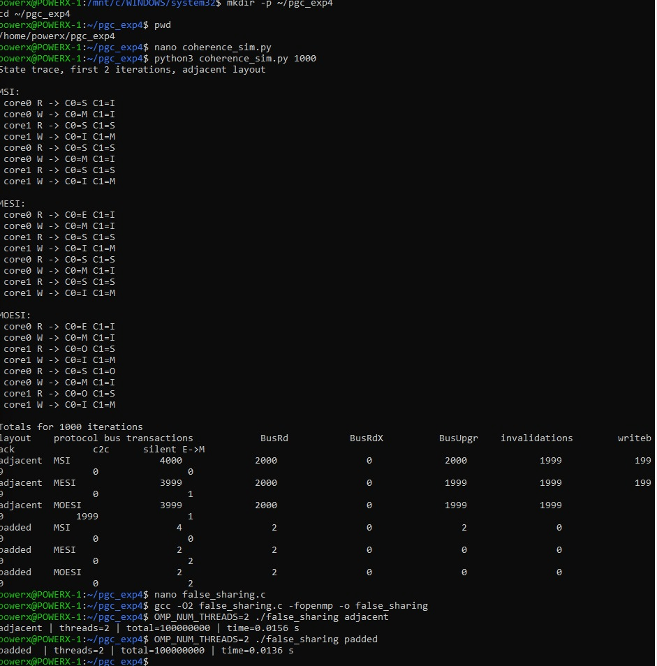
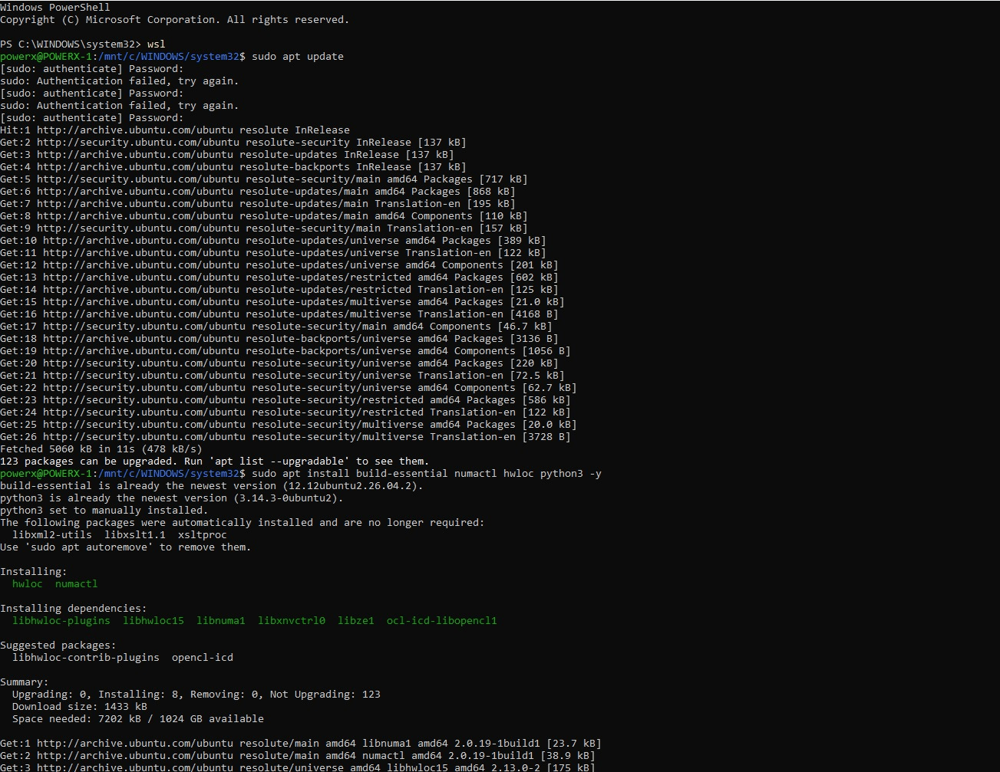
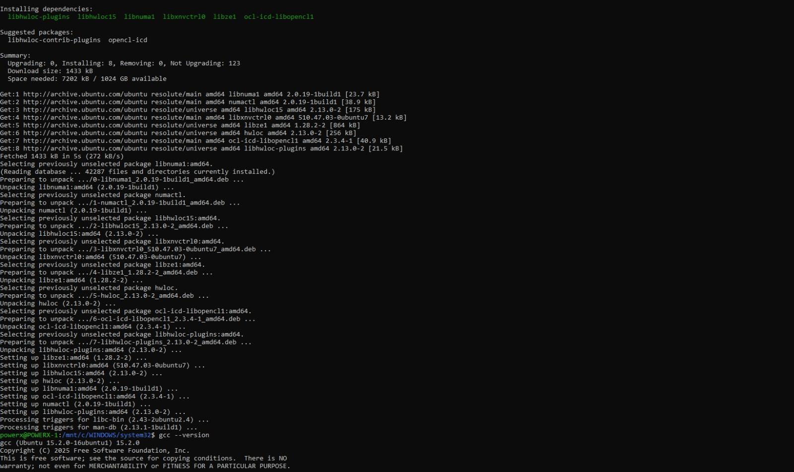
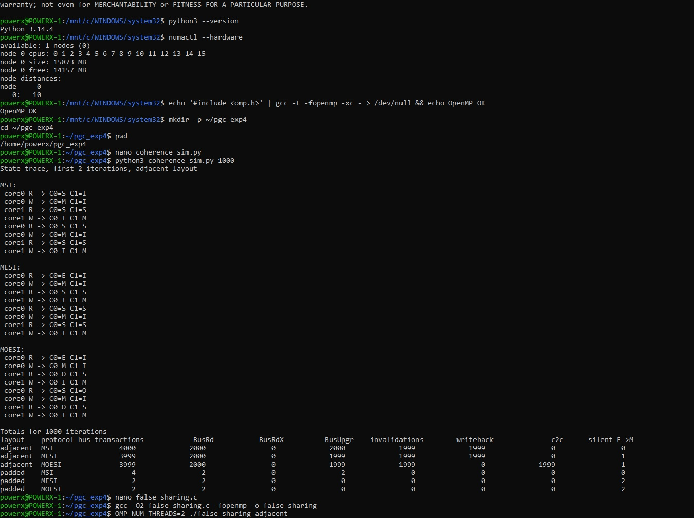
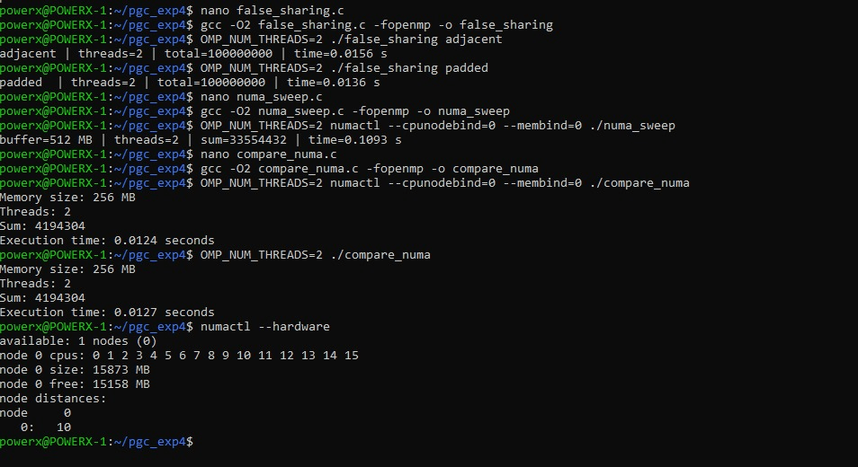

# Experiment 3 – Cache Coherence and NUMA Memory Access Performance

### PGC Lab Experiments

---

## 1. Experiment Overview

This experiment studies cache coherence protocols and NUMA (Non-Uniform Memory Access) performance in multi-core processors.

The experiment focuses on three cache coherence protocols:

- MSI (Modified, Shared, Invalid)
- MESI (Modified, Exclusive, Shared, Invalid)
- MOESI (Modified, Owned, Exclusive, Shared, Invalid)

It also investigates false sharing and memory access performance using NUMA tools.

The experiment uses Python for cache coherence simulation and C with OpenMP for parallel performance benchmarking.

## 2. Objectives

- Understand cache coherence in multi-core processors.
- Study MSI, MESI and MOESI protocols.
- Understand cache-line state transitions.
- Analyze false sharing between multiple threads.
- Compare adjacent and padded memory layouts.
- Understand NUMA architecture.
- Measure NUMA memory access performance.
- Compare execution time using different benchmark programs.

## 3. Technologies Used

| Technology | Purpose |
|---|---|
| C | Benchmark implementation |
| Python 3 | Cache coherence simulation |
| GCC | C program compilation |
| OpenMP | Multi-threaded programming |
| numactl | NUMA memory and CPU binding |
| hwloc | Hardware topology inspection |
| Ubuntu WSL | Linux execution environment |
| Windows PowerShell | Starting the WSL environment |

## 4. Hardware and Software Configuration

| Component | Observed Configuration |
|---|---|
| Environment | Ubuntu on WSL |
| GCC Version | 15.2.0 |
| Python Version | 3.14.4 |
| OpenMP | Available |
| NUMA Utility | numactl |
| Hardware Topology Tool | hwloc |
| NUMA Nodes Detected | 1 |
| NUMA Node | Node 0 |
| CPUs Listed | 0–15 |
| Memory Reported for Node 0 | Approximately 15,873 MB |

**Note:** The values above are taken from the recorded terminal output. They describe the WSL environment used for this experiment.

## 5. Experiment Description

### 5.1 Cache Coherence Protocol Simulation

The Python program simulates three cache coherence protocols:

- MSI
- MESI
- MOESI

The simulation displays cache state transitions for two processor cores.

It also compares protocol statistics such as:

- Bus transactions
- BusRd
- BusRdX
- BusUpgr
- Invalidations
- Write-backs
- Cache-to-cache transfers
- Silent Exclusive-to-Modified transitions

### 5.2 False Sharing

False sharing occurs when multiple threads modify different variables that belong to the same cache line.

This experiment compares two memory layouts:

**Adjacent layout**
- Counters are placed next to each other.
- Multiple threads may access variables in the same cache line.

**Padded layout**
- Counters are separated using padding.
- This helps reduce false sharing.

The execution time of both layouts is measured and compared.

### 5.3 NUMA Memory Sweep

The NUMA memory sweep program measures memory processing performance using OpenMP threads.

The experiment uses `numactl` to bind CPU execution and memory allocation to NUMA node 0.

### 5.4 Performance Comparison

The comparison program measures execution time using a 256 MB memory workload and two OpenMP threads.

The experiment compares execution with explicit NUMA node binding and without explicit NUMA binding.

## 6. Installation and Environment Setup

The following commands were used in Ubuntu WSL.

### 6.1 Update Ubuntu Packages

```bash
sudo apt update
```

### 6.2 Install Required Packages

```bash
sudo apt install build-essential numactl hwloc python3 -y
```

### 6.3 Verify GCC

```bash
gcc --version
```

### 6.4 Verify Python

```bash
python3 --version
```

### 6.5 Verify OpenMP

```bash
echo '#include <omp.h>' | gcc -E -fopenmp -xc - > /dev/null && echo OpenMP OK
```

### 6.6 Check NUMA Hardware

```bash
numactl --hardware
```

### 6.7 Check CPU Information

```bash
lscpu
```

## 7. Compilation and Execution Commands

Open Ubuntu WSL and enter the experiment directory:

```bash
cd ~/pgc_exp4
```

### 7.1 Program 1 – Cache Coherence Simulation

Run the simulator:

```bash
python3 coherence_sim.py 1000
```

This command executes 1000 simulation iterations and displays state transitions and protocol statistics for MSI, MESI and MOESI.

### 7.2 Program 2 – False Sharing Benchmark

Compile the C program:

```bash
gcc -O2 false_sharing.c -fopenmp -o false_sharing
```

Run with adjacent counters:

```bash
OMP_NUM_THREADS=2 ./false_sharing adjacent
```

Run with padded counters:

```bash
OMP_NUM_THREADS=2 ./false_sharing padded
```

These commands compare the execution time of adjacent and padded counter layouts using two threads.

### 7.3 Program 3 – NUMA Memory Sweep

Compile:

```bash
gcc -O2 numa_sweep.c -fopenmp -o numa_sweep
```

Run with CPU and memory binding to NUMA node 0:

```bash
OMP_NUM_THREADS=2 numactl --cpunodebind=0 --membind=0 ./numa_sweep
```

### 7.4 Program 4 – NUMA Performance Comparison

Compile:

```bash
gcc -O2 compare_numa.c -fopenmp -o compare_numa
```

Run with NUMA node 0 binding:

```bash
OMP_NUM_THREADS=2 numactl --cpunodebind=0 --membind=0 ./compare_numa
```

Run without explicit NUMA binding:

```bash
OMP_NUM_THREADS=2 ./compare_numa
```

## 8. Experimental Results

### 8.1 False Sharing Results

The recorded execution results were:

| Configuration | Threads | Total Increments | Execution Time |
|---|---:|---:|---:|
| Adjacent | 2 | 100,000,000 | 0.0156 seconds |
| Padded | 2 | 100,000,000 | 0.0136 seconds |

The padded layout recorded a lower execution time in this run.

### 8.2 Cache Coherence Simulation

The simulator was executed for 1000 iterations.

The output showed differences in bus transactions, invalidations, write-backs, cache-to-cache transfers and silent transitions across MSI, MESI and MOESI.

The simulation also compared adjacent and padded layouts.

### 8.3 NUMA Memory Sweep

Recorded output:

| Parameter | Result |
|---|---:|
| Buffer Size | 512 MB |
| Threads | 2 |
| Sum | 33,554,432 |
| Execution Time | 0.1093 seconds |

### 8.4 NUMA Performance Comparison

Recorded output:

| Parameter | Result |
|---|---:|
| Memory Size | 256 MB |
| Threads | 2 |
| Sum | 4,194,304 |

Execution time:

| Execution Configuration | Execution Time |
|---|---:|
| NUMA node 0 binding | 0.0124 seconds |
| Without explicit NUMA binding | 0.0127 seconds |

These are the observed results from the recorded execution. Timing can vary depending on system load and hardware.

### 8.5 NUMA Topology Observation

The command:

```bash
numactl --hardware
```

reported:

- One NUMA node available.
- Node 0 contains CPUs 0–15.
- Node 0 memory was approximately 15,873 MB.

**Important limitation:** Since only one NUMA node was detected, this environment could not demonstrate a comparison between local and remote NUMA nodes. The experiment therefore records node 0 memory binding and an unbound execution, not a local-versus-remote memory comparison.

## 9. Execution Screenshots

The following screenshots document the actual setup, compilation and experiment outputs.

### 9.1 Cache Coherence and False Sharing

Shows the cache coherence simulation and false-sharing benchmark output.



### 9.2 Ubuntu Package Installation

Shows the Ubuntu package update and installation of the required development tools.



### 9.3 Development Environment

Shows the installed development environment and GCC version.



### 9.4 Cache Coherence Simulation Output

Shows the MSI, MESI and MOESI simulation output, NUMA topology information and false-sharing execution.



### 9.5 NUMA and Performance Benchmark Results

Shows the NUMA memory sweep and performance comparison program output.



## 10. Project Directory Structure

```text
03-Cache-Coherence-NUMA/
│
├── README.md
│
├── coherence_sim.py
├── false_sharing.c
├── numa_sweep.c
├── compare_numa.c
│
└── screenshots/
    ├── 01-cache-coherence-false-sharing.png
    ├── 02-ubuntu-package-installation.png
    ├── 03-development-environment.png
    ├── 04-coherence-simulation-output.png
    └── 05-numa-performance-results.png
```

## 11. Conclusion

This experiment demonstrates cache coherence protocols and memory performance concepts in multi-core computing environments.

The MSI, MESI and MOESI simulation illustrates cache state transitions and protocol statistics.

The false-sharing benchmark compares adjacent and padded memory layouts and shows the effect of padding on execution time.

The NUMA experiments demonstrate memory benchmarking with CPU and memory binding. The WSL environment detected only one NUMA node, which limited testing to node 0 rather than a local-versus-remote NUMA comparison.

Overall, this experiment provided practical experience with cache coherence, OpenMP, false sharing, NUMA tools and multi-core performance analysis.

---

**PGC Lab – Experiment 3: Cache Coherence and NUMA Memory Access Performance**
