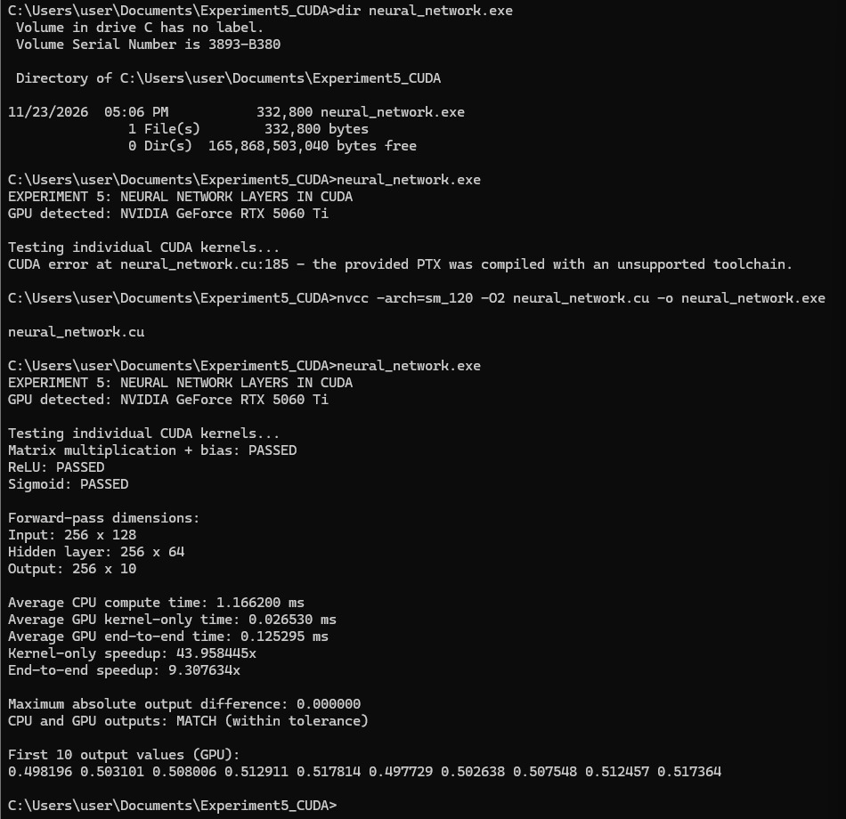

# Experiment 5 – Neural Network Layers in CUDA

## Overview

This experiment implements neural network operations using NVIDIA CUDA and compares CPU and GPU computation performance.

## GPU Configuration

- GPU: NVIDIA GeForce RTX 5060 Ti
- CUDA architecture: sm_120
- Programming language: CUDA C++

## Neural Network Dimensions

| Layer | Dimensions |
|---|---|
| Input | 256 × 128 |
| Hidden | 256 × 64 |
| Output | 256 × 10 |

## CUDA Kernel Tests

- Matrix multiplication + bias: PASSED
- ReLU activation: PASSED
- Sigmoid activation: PASSED

## Performance Results

| Measurement | Result |
|---|---:|
| Average CPU compute time | 1.166200 ms |
| Average GPU kernel-only time | 0.026530 ms |
| Average GPU end-to-end time | 0.125295 ms |
| Kernel-only speedup | 43.958445× |
| End-to-end speedup | 9.307634× |
| Maximum absolute output difference | 0.000000 |
| CPU and GPU outputs | MATCH |

## Compilation and Execution

Compile:

```bash
nvcc -arch=sm_120 -O2 neural_network.cu -o neural_network.exe
```

Execute:

```bash
neural_network.exe
```

## Execution Screenshot



## Conclusion

The experiment successfully implemented neural network layers using CUDA. All individual CUDA kernel tests passed, and the CPU and GPU outputs matched within tolerance. GPU execution demonstrated improved performance compared with CPU computation.
