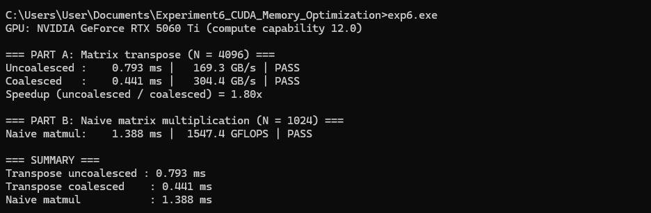

# Experiment 6 – CUDA Memory Optimization

## 1. Overview

This experiment studies GPU global memory access optimization using NVIDIA CUDA.

It compares uncoalesced and coalesced memory access patterns in matrix transpose operations and evaluates the performance of naive matrix multiplication.

The main objective is to understand how memory access patterns affect GPU performance.

## 2. Technologies Used

- CUDA C/C++
- NVIDIA CUDA Toolkit
- NVIDIA GeForce RTX 5060 Ti
- Windows
- Visual Studio Build Tools

## 3. GPU Configuration

| Component | Specification |
|---|---|
| GPU | NVIDIA GeForce RTX 5060 Ti |
| Compute Capability | 12.0 |
| CUDA Architecture | sm_120 |
| Programming Language | CUDA C++ |

## 4. Experiment Details

### Part A – Matrix Transpose

Matrix transpose is performed using two different memory access approaches.

**Uncoalesced memory access**

- Uses a simple transpose kernel.
- Threads access memory in a less efficient pattern.
- Results in less efficient global memory transactions.

**Coalesced memory access**

- Uses shared memory to reorganize data.
- Improves global memory access patterns.
- Allows threads to access consecutive memory locations efficiently.

Matrix size: 4096 × 4096.

### Part B – Naive Matrix Multiplication

- Implements matrix multiplication using CUDA.
- Each GPU thread calculates one output element.
- Evaluates execution time and floating-point performance.

Matrix size: 1024 × 1024.

## 5. Experimental Results

### Part A – Matrix Transpose (N = 4096)

| Configuration | Execution Time | Bandwidth |
|---|---:|---:|
| Uncoalesced | 0.793 ms | 169.3 GB/s |
| Coalesced | 0.441 ms | 304.4 GB/s |

**Speedup: 1.80×**

### Part B – Naive Matrix Multiplication (N = 1024)

| Measurement | Result |
|---|---:|
| Execution Time | 1.388 ms |
| Performance | 1547.4 GFLOPS |
| Validation | PASS |

## 6. Compilation and Execution

Compile the CUDA program:

```bash
nvcc -arch=sm_120 -O2 exp6.cu -o exp6.exe
```

Run the executable:

```bash
exp6.exe
```

## 7. Execution Screenshot

The following screenshot shows the actual experiment output.



## 8. Key Observations

- Coalesced memory access achieved better performance than uncoalesced memory access.
- Matrix transpose execution time decreased from 0.793 ms to 0.441 ms in the recorded run.
- Coalesced memory access achieved a speedup of 1.80×.
- Naive matrix multiplication achieved 1547.4 GFLOPS in the recorded run.
- All reported validation tests passed.

## 9. Conclusion

This experiment demonstrates the importance of efficient global memory access in GPU programming.

The coalesced matrix transpose implementation performed better than the uncoalesced implementation. The experiment also provided practical experience with CUDA matrix multiplication and GPU performance measurement.

---

**PGC CUDA Lab – Experiment 6: CUDA Memory Optimization**
