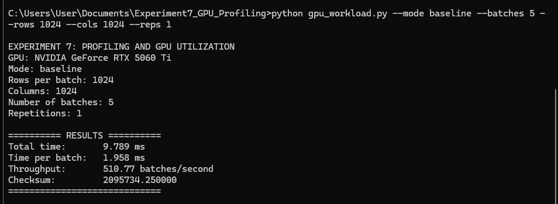
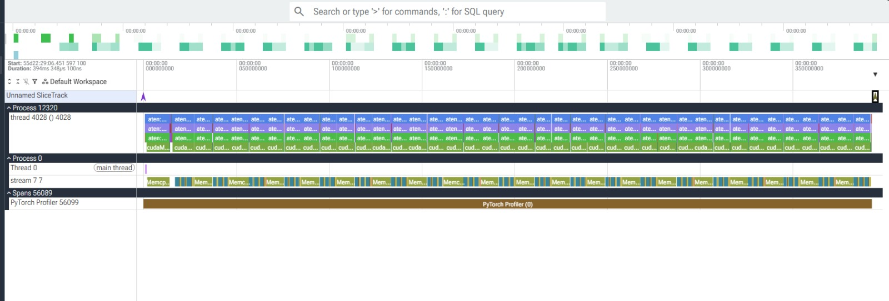
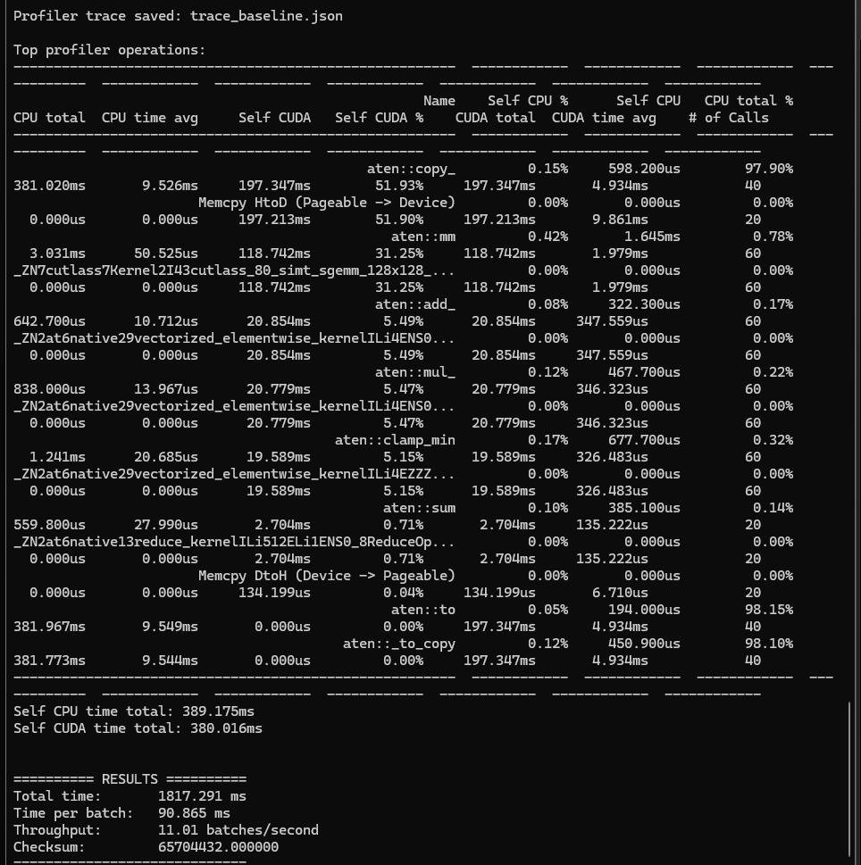
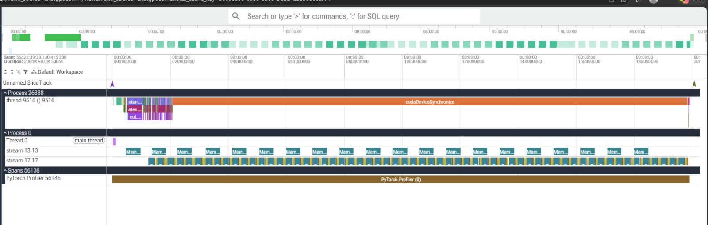
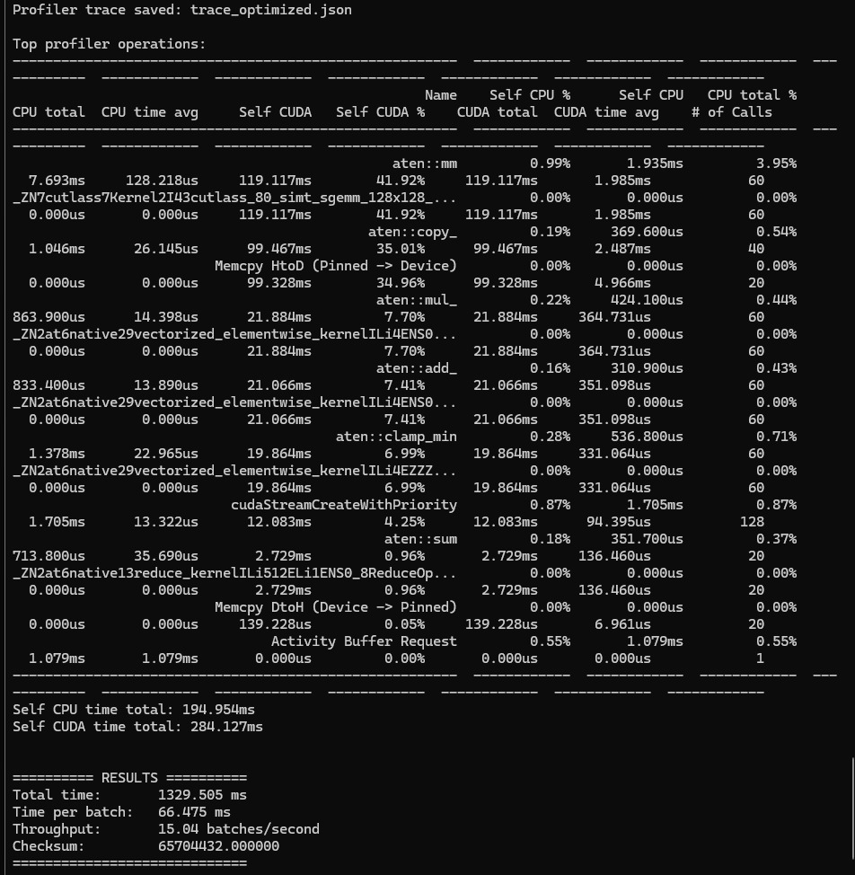

# Experiment 7 – Profiling and GPU Utilization

## 1. Experiment Overview

Experiment 7 focuses on GPU profiling and utilization analysis using Python and PyTorch.

The experiment executes a GPU workload and studies its performance using profiling tools. It compares baseline and optimized execution to understand GPU computation, memory transfers, CUDA operations, and execution time.

The main objective is to understand how profiling helps identify performance bottlenecks and evaluate GPU workload optimization.

## 2. Objectives

- Execute a computational workload using the GPU.
- Understand GPU utilization during execution.
- Measure total execution time and time per batch.
- Calculate workload throughput.
- Analyze CUDA operations using PyTorch Profiler.
- Visualize CPU and GPU activities using NVIDIA Nsight Systems.
- Compare baseline and optimized execution.
- Understand the effect of memory transfers on GPU performance.

## 3. Technologies Used

| Technology | Purpose |
|---|---|
| Python | Workload implementation |
| PyTorch | GPU computation |
| CUDA | GPU execution |
| NVIDIA Nsight Systems | GPU timeline profiling |
| PyTorch Profiler | Operation-level performance analysis |
| NVIDIA GPU | Parallel computation |

## 4. Hardware Configuration

| Component | Specification |
|---|---|
| GPU | NVIDIA GeForce RTX 5060 Ti |
| Compute Capability | 12.0 |
| Operating System | Windows |
| Programming Language | Python |

## 5. Experimental Methodology

The experiment performs repeated matrix-based GPU computations using batches of data.

Two execution modes are considered:

### 5.1 Baseline Mode

The baseline mode executes the workload using ordinary CPU memory transfers to the GPU.

The execution is measured using:
- Total execution time
- Time per batch
- Throughput
- Checksum

### 5.2 Optimized Mode

The optimized mode uses pinned host memory and asynchronous memory transfers where supported.

This helps study how memory transfer techniques can influence GPU workload execution.

## 6. Execution Commands

### Run Baseline Mode

```bash
python gpu_workload.py --mode baseline --batches 5 --rows 1024 --cols 1024 --reps 1
```

### Run Optimized Mode

```bash
python gpu_workload.py --mode optimized --batches 5 --rows 1024 --cols 1024 --reps 1
```

### Generate Baseline Profiler Trace

```bash
python gpu_workload.py --mode baseline --batches 5 --rows 1024 --cols 1024 --reps 1 --profile
```

### Generate Optimized Profiler Trace

```bash
python gpu_workload.py --mode optimized --batches 5 --rows 1024 --cols 1024 --reps 1 --profile
```

## 7. Experimental Results

### 7.1 Baseline Execution

The recorded baseline screenshot shows:

| Measurement | Result |
|---|---:|
| Rows per batch | 1024 |
| Columns | 1024 |
| Number of batches | 5 |
| Repetitions | 1 |
| Total time | 9.789 ms |
| Time per batch | 1.958 ms |
| Throughput | 510.77 batches/second |
| Checksum | 2095734.250000 |

### 7.2 Baseline Profiling

The baseline profiler output identifies operations including:

- Matrix multiplication (`aten::mm`)
- Tensor copy (`aten::copy_`)
- Addition (`aten::add`)
- Multiplication (`aten::mul`)
- Reduction (`aten::sum`)

The baseline profiling screenshot also shows pageable host-to-device memory transfers.

### 7.3 Optimized Profiling

The optimized profiler output shows GPU operations and memory transfers during optimized execution.

The screenshot includes pinned-memory host-to-device transfers and CUDA stream activity.

### 7.4 Performance Comparison

The recorded profiler screenshots show these total execution times:

| Measurement | Baseline | Optimized |
|---|---:|---:|
| Total time | 1817.291 ms | 1329.505 ms |
| Time per batch | 90.865 ms | 66.475 ms |
| Throughput | 11.01 batches/sec | 15.04 batches/sec |
| Checksum | 65704432.000000 | 65704432.000000 |

**Note:** These profiler-run timings are separate from the 9.789 ms baseline execution screenshot. Profiling introduces overhead, so the measurements should not be directly mixed.

## 8. Screenshots

### 8.1 Baseline Execution

Shows baseline workload execution, total time, throughput, and checksum.



### 8.2 Baseline Nsight Systems Timeline

Shows CPU and GPU activity during baseline execution.



### 8.3 Baseline Profiler Output

Shows the operations and their measured CPU and CUDA times.



### 8.4 Optimized Nsight Systems Timeline

Shows the GPU activity timeline during optimized execution.



### 8.5 Optimized Profiler Output

Shows the operations and performance measurements during optimized execution.



## 9. Project Structure

```text
Experiment7_GPU_Profiling/
│
├── README.md
├── gpu_workload.py
├── requirements.txt
│
└── screenshots/
    ├── 01_baseline_execution.png
    ├── 02_baseline_nsys_timeline.png
    ├── 03_baseline_profiler_output.png
    ├── 04_optimized_nsys_timeline.png
    └── 05_optimized_profiler_output.png
```

## 10. Conclusion

Experiment 7 demonstrates GPU workload profiling and utilization analysis using PyTorch Profiler and NVIDIA Nsight Systems.

The experiment compares baseline and optimized execution, examines CUDA operations, and studies memory-transfer behavior.

It provides practical experience in GPU performance measurement, profiling, identifying bottlenecks, and understanding optimization techniques.

---

**Experiment 7 – Profiling and GPU Utilization**

