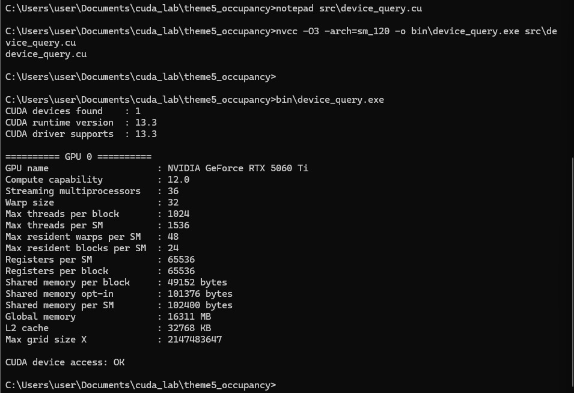
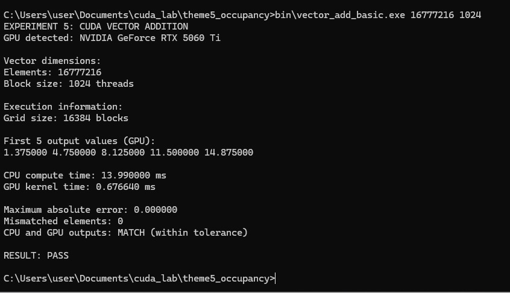
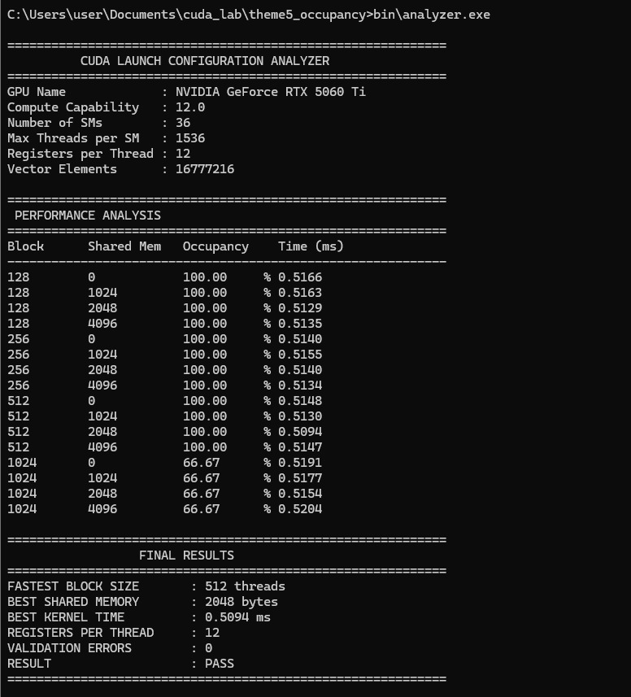
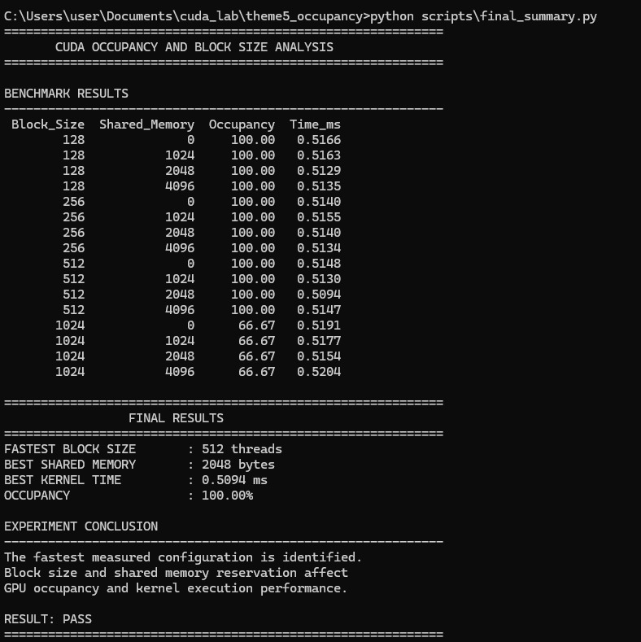

# CUDA Launch Configuration Analyzer
### PGC CUDA Lab Evaluation – Theme 5: Occupancy and Block Size Tuning

---

## 1. Project Overview

The **CUDA Launch Configuration Analyzer** is a GPU performance analysis project developed using NVIDIA CUDA.

The project investigates how different CUDA kernel launch configurations affect GPU occupancy and execution time.

Using a CUDA vector addition program, we evaluate different thread block sizes and dynamic shared-memory reservations to understand their impact on GPU resource utilization and kernel performance.

The main goal is to analyze different configurations and identify the configuration that provides the fastest measured execution time.

## 2. Project Objectives

- Understand CUDA grid and thread block configurations.
- Analyze the effect of block size on GPU occupancy.
- Study register usage per thread.
- Investigate dynamic shared-memory reservation.
- Measure CUDA kernel execution time.
- Compare different GPU launch configurations.
- Identify the best-performing configuration among the tested configurations.

## 3. Technologies Used

| Technology | Purpose |
|---|---|
| CUDA C/C++ | GPU programming |
| NVIDIA CUDA Toolkit | CUDA compilation and execution |
| Python | Experimental result analysis |
| Pandas | Data processing |
| Matplotlib | Performance visualization |
| Visual Studio Build Tools | CUDA compilation on Windows |

## 4. Hardware and Software Configuration

| Component | Specification |
|---|---|
| GPU | NVIDIA GeForce RTX 5060 Ti |
| Compute Capability | 12.0 |
| Streaming Multiprocessors | 36 |
| Warp Size | 32 |
| Maximum Threads per Block | 1024 |
| CUDA Runtime Version | 13.3 |
| Operating System | Windows |
| Python Version | 3.12 |

## 5. Project Architecture and Workflow

The project follows a sequence of GPU device detection, CUDA kernel execution, occupancy analysis, performance measurement, and result analysis.

### Workflow

1. **GPU Detection:** Identify the available NVIDIA GPU and collect its hardware specifications.
2. **CUDA Vector Addition:** Execute vector addition on the GPU and compare its output with CPU computation.
3. **Launch Configuration:** Test different CUDA thread block sizes.
4. **Resource Analysis:** Evaluate register usage, theoretical occupancy, and dynamic shared-memory reservations.
5. **Performance Measurement:** Record kernel execution time for each configuration.
6. **Result Analysis:** Process and compare the experimental results using Python.
7. **Configuration Selection:** Identify the fastest measured configuration.

## 6. Experimental Methodology

The experiment uses CUDA vector addition to study the impact of different launch configurations on GPU performance.

### 6.1 Block Size Configurations

The following thread block sizes were tested:

- 128 threads
- 256 threads
- 512 threads
- 1024 threads

### 6.2 Dynamic Shared-Memory Configurations

The following shared-memory reservations were tested:

- 0 bytes
- 1024 bytes
- 2048 bytes
- 4096 bytes

### 6.3 Benchmark Configuration

| Parameter | Value |
|---|---:|
| Benchmark Vector Size | 16,777,216 elements |
| Number of Block Sizes | 4 |
| Number of Shared-Memory Configurations | 4 |
| Total Configurations Tested | 16 |

Each configuration was evaluated using theoretical occupancy and measured CUDA kernel execution time.

## 7. Experimental Results and Analysis

The experiment evaluated 16 combinations of block size and dynamic shared-memory reservation.

### 7.1 Occupancy Results

- Block sizes of 128, 256, and 512 threads achieved 100% theoretical occupancy across the tested reservations.
- The 1024-thread block configurations achieved 66.67% theoretical occupancy.
- Occupancy was evaluated using CUDA resource information and occupancy calculations.

### 7.2 Best Measured Configuration

The fastest measured configuration was:

| Parameter | Result |
|---|---:|
| Block Size | 512 threads |
| Dynamic Shared-Memory Reservation | 2048 bytes |
| Theoretical Occupancy | 100% |
| Registers per Thread | 12 |
| Kernel Execution Time | 0.5094 ms |
| Validation Errors | 0 |
| Result | PASS |

### 7.3 Key Observations

- Block size influences theoretical GPU occupancy.
- Different launch configurations produce different measured execution times.
- The 512-thread configuration with a 2048-byte reservation achieved the lowest measured kernel execution time.
- The 1024-thread configurations showed lower theoretical occupancy in this experiment.

**Note:** Dynamic shared memory was reserved for resource analysis but was not used in the actual vector addition calculation. Therefore, this experiment studies the effect of resource reservation rather than shared-memory computation.

## 8. Project Execution Screenshots

The following screenshots demonstrate the actual execution of the CUDA programs, GPU detection, correctness verification, and performance analysis.

### 8.1 GPU Device Information

Displays the detected NVIDIA GeForce RTX 5060 Ti and its hardware specifications, including compute capability, streaming multiprocessors, warp size, and memory information.



### 8.2 CUDA Vector Addition – Correctness Test 1

Vector addition execution using 1,048,576 elements and a block size of 256 threads.

- CPU and GPU outputs match.
- Maximum absolute error: 0.000000
- Mismatched elements: 0
- Result: PASS


### 8.3 CUDA Vector Addition – Correctness Test 2

Large vector addition execution using 16,777,216 elements and a block size of 1024 threads.

- CPU and GPU outputs match.
- Maximum absolute error: 0.000000
- Mismatched elements: 0
- Result: PASS



### 8.4 CUDA Launch Configuration Analyzer

Displays the performance analysis across different block sizes and dynamic shared-memory reservations.

The analyzer reports:

- GPU information
- Block size
- Shared-memory reservation
- Theoretical occupancy
- Kernel execution time
- Register usage per thread
- Validation errors



### 8.5 Final Benchmark Summary

Displays the final benchmark comparison and identifies the fastest measured configuration among the 16 tested configurations.

**Final result:**
- Fastest block size: 512 threads
- Best shared-memory reservation: 2048 bytes
- Kernel execution time: 0.5094 ms
- Theoretical occupancy: 100%
- Result: PASS



## 9. Project Directory Structure

```text
cuda-occupancy-block-tuning/
│
├── README.md
│
├── src/
│   ├── device_query.cu
│   ├── vector_add_basic.cu
│   └── analyzer.cu
│
├── scripts/
│   ├── plot_results.py
│   └── final_summary.py
│
├── screenshots/
│   ├── gpu_device_information.png
│   ├── vector_add_test_1.png
│   ├── vector_add_test_2.png
│   ├── cuda_analyzer_output.png
│   └── final_benchmark_summary.png
│
├── requirements.txt
│
└── .gitignore
```

## 10. Team Members and Contributions

This project was developed collaboratively by a team of four members.

| Team Member | Contribution |
|---|---|
| Member 1 – Abhinandan | CUDA device information and vector addition implementation |
| Member 2 – Pradeep | CUDA occupancy analyzer and launch configuration experiments |
| Member 3 – Bhavana | Python-based result analysis and visualization |
| Member 4 – Zakiya | Testing, documentation, and GitHub repository management |

## 11. Conclusion

The CUDA Launch Configuration Analyzer demonstrates how different CUDA kernel launch configurations influence GPU resource utilization and execution performance.

By evaluating different thread block sizes and dynamic shared-memory reservations, we identified the fastest measured configuration among the tested experiments.

The experiment achieved 100% theoretical occupancy and a measured kernel execution time of 0.5094 ms with a block size of 512 threads and a 2048-byte dynamic shared-memory reservation.

This project provided practical experience in CUDA programming, GPU occupancy analysis, kernel benchmarking, and performance evaluation.

---

**PGC CUDA Lab Evaluation – Theme 5: Occupancy and Block Size Tuning**
